# BattleClass

A head-to-head presentation duel scoreboard and weighted voting platform with real-time comprehension checks.

---

## Background

Built to turn passive classroom presentations into active technical debates. Students were tuning out during student-led seminars, so we turned the session into a head-to-head debate with real-time comprehension checks and weighted voting. Built in [Month Year] for [Course/Context], it has been used in [number] live sessions with [number] students.

---

## Key Features

### Stage Scoreboard Display
- **Fullscreen Classroom View:** High-contrast 1080p layout designed for classroom projectors.
- **Dynamic Join QR Code:** Displays public battle PIN and scannable QR code for zero-friction student onboarding.
- **Speaking Countdown Ring:** Circular SVG countdown ring synchronized authoritatively with server clock.
- **Order of Play Wheel:** Animated randomizer wheel to determine which challenger speaks first.
- **Real-Time Checkpoint Reveals:** Displays audience accuracy distribution bar charts and explanations.
- **Live Voting Turnout:** Live participation progress tracking votes cast against room headcount.
- **Winner Reveal & Podium:** Side-by-side criteria breakdown and victor celebration.

### Student Mobile Interface
- **Zero-Install Web App:** Mobile-optimized responsive interface accessible via any phone browser.
- **Live Understanding Checks:** Multiple-choice comprehension prompts delivered in real time during talks.
- **Vote Power Tracker:** Live gauge tracking earned voting weight and matched-pair balance across challengers.
- **Multi-Criteria Ballot:** Structured voting across Clarity, Technical Depth, and Argument Strength.
- **Rules & Info Drawer:** Slide-over modal explaining comprehension scoring and vote weighting mechanics.

### Organizer Control Console
- **Battle Setup & Timing:** Configure speaking budgets, extra time allowances, and question counts.
- **Question Bank Import:** Structured JSON question import with validation and vetting toggles.
- **Readiness Validator:** Pre-flight checklist verifying speaker names, topics, timing, and question pools.
- **Live Control Room:** Speaking clock controls (start, pause, resume, extend), question triggers, and voting gates.
- **Multi-Battle Management:** Tournaments roster dashboard with batch approvals and status filtering.

### Analytics & Reports
- **Multi-Sheet Excel Exports:** Full session exports containing high-level summaries, attendee engagement logs, item-level question performance, and complete ballot registries.
- **Comprehension Item Analysis:** Per-question accuracy rates and answer distributions to help instructors evaluate cohort understanding of technical concepts.
- **Time Compliance Auditing:** Active speaking time tracking with overtime calculation per presenter.

---

## How a Battle Works

```
[1. Setup & Vetting]       Admin imports question pool, sets speaking limits, and validates readiness checklist.
         ↓
[2. Order of Play Draw]    Randomizer wheel draws which challenger presents first. Stage lobby opens for student joins.
         ↓
[3. Presentation 1]        Speaker 1 presents. Host launches comprehension checks; speaking clock pauses during questions.
         ↓
[4. Changeover & 2]        Intermission resets clock. Speaker 2 presents and delivers comprehension checks.
         ↓
[5. Weighted Voting]       Audience votes across 3 criteria. Students who engaged with both speakers receive higher vote weight.
         ↓
[6. Results Reveal]        Stage displays winner, weighted score margins, criteria breakdowns, and generates Excel reports.
```

1. **Setup & Vetting:** The instructor creates a battle (e.g., *Gradient Descent vs Newton-Raphson*), configures speaking durations (e.g., 5:00 each), imports a JSON question pool, and verifies the readiness checklist.
2. **Order of Play Draw:** The animated randomizer determines which presenter speaks first. The stage projector displays the join code and QR code. Students enter their display names on their phones.
3. **Challenger 1 Presentation:** Speaker 1 presents. At strategic moments, the organizer triggers comprehension checks. The speaking timer pauses while students answer on their phones within a 15–20s window. Results and explanations reveal immediately.
4. **Changeover & Challenger 2 Presentation:** Speaker 2 takes the stage. The clock resets to the allocated duration. Speaker 2 presents and delivers their comprehension checks.
5. **Weighted Voting:** The organizer opens the voting window. Students cast ballots across three judging criteria (Clarity, Technical Depth, Argument Strength). Students who answered questions correctly for both presenters earn a **1.0x–1.3x** vote weight; students who only paid attention to one presenter are capped at **0.5x**.
6. **Results Reveal & Reports:** The stage reveals the tournament winner, criteria score comparisons, and raw vs. weighted margins. Full Excel logs are downloaded for course grading.

---

## Screenshot Gallery

### Stage Projector Interface (1920 × 1080)
| Lobby & Join QR Code | Live Presentation & Countdown Ring |
| :---: | :---: |
| 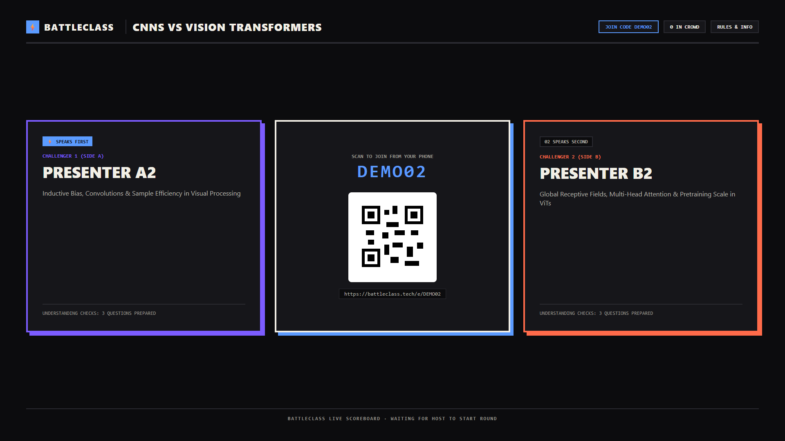 | 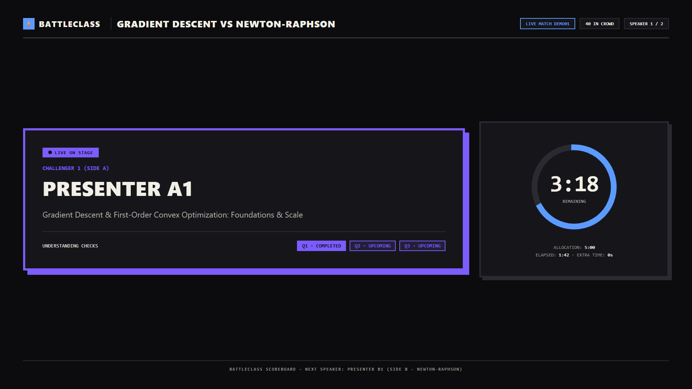 |
| *High-contrast classroom lobby displaying join code and QR.* | *Live speaker spotlight with countdown ring and question tracker.* |

| Live Audience Voting Turnout | Final Outcome & Victory Podium |
| :---: | :---: |
| 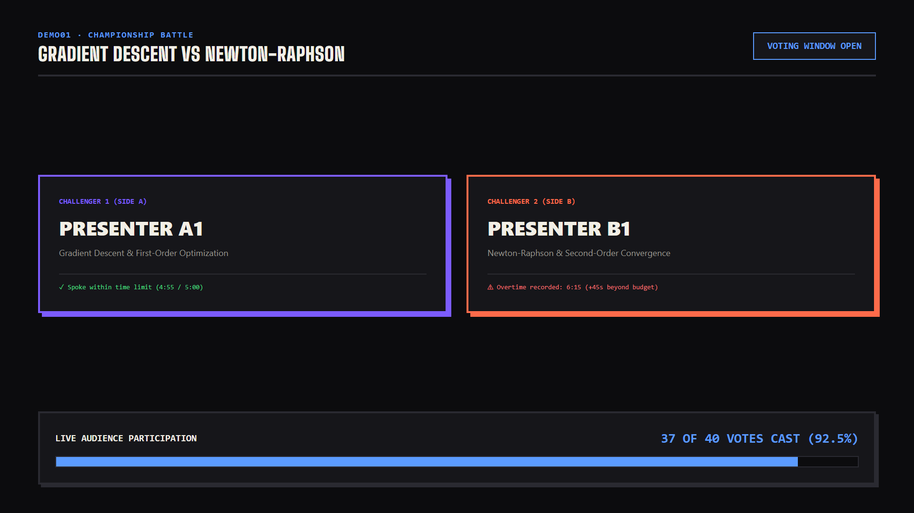 | 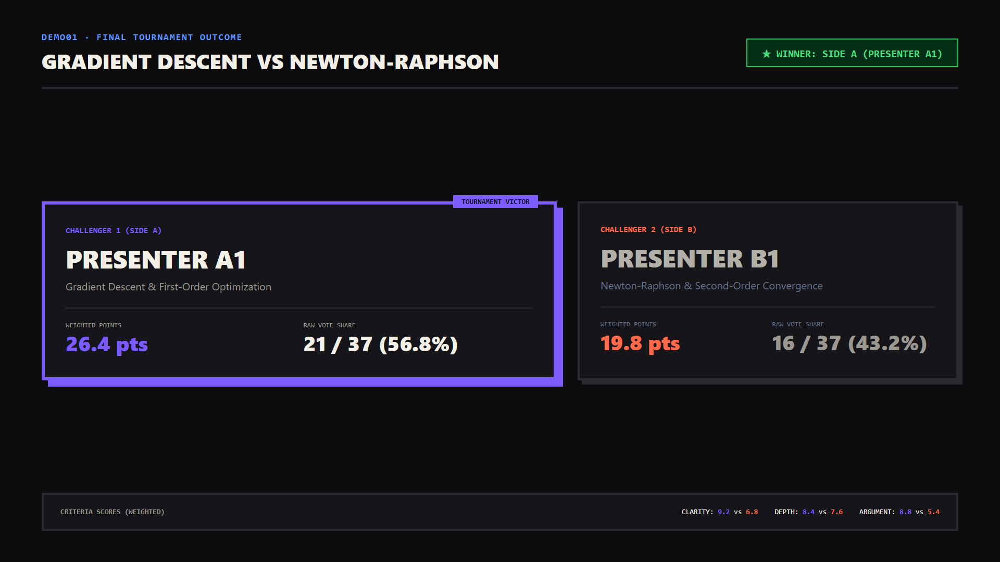 |
| *Real-time turnout counter tracking votes against room headcount.* | *Winner announcement with weighted score breakdown.* |

---

### Student Mobile Interface (390 × 844)
| Understanding Check | Correct Answer Reveal | Missed Check State |
| :---: | :---: | :---: |
| 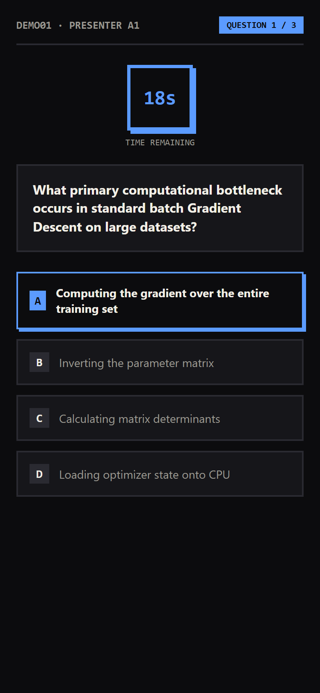 | 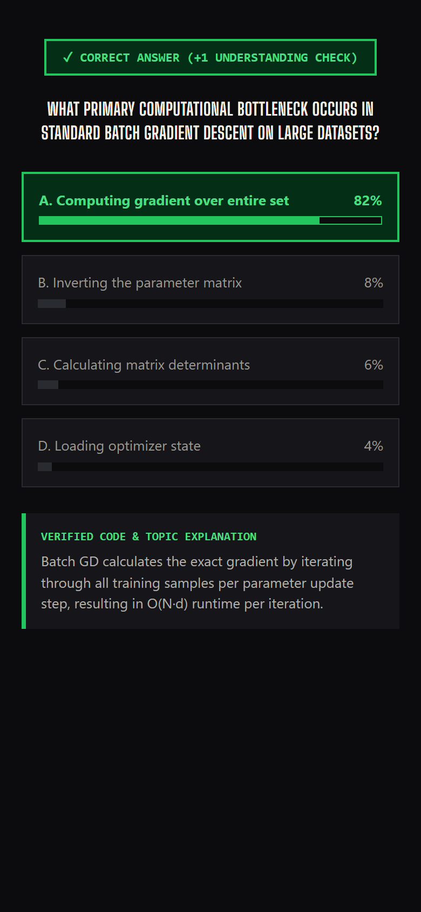 | 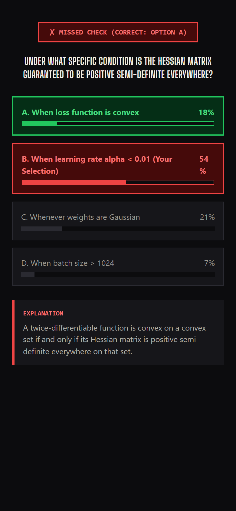 |
| *Live multiple-choice prompt.* | *Immediate explanation & +1 weight.* | *Missed check & audience distribution.* |

| Vote Weight Tracker | Criteria Voting Ballot | Turnout Waiting View |
| :---: | :---: | :---: |
| 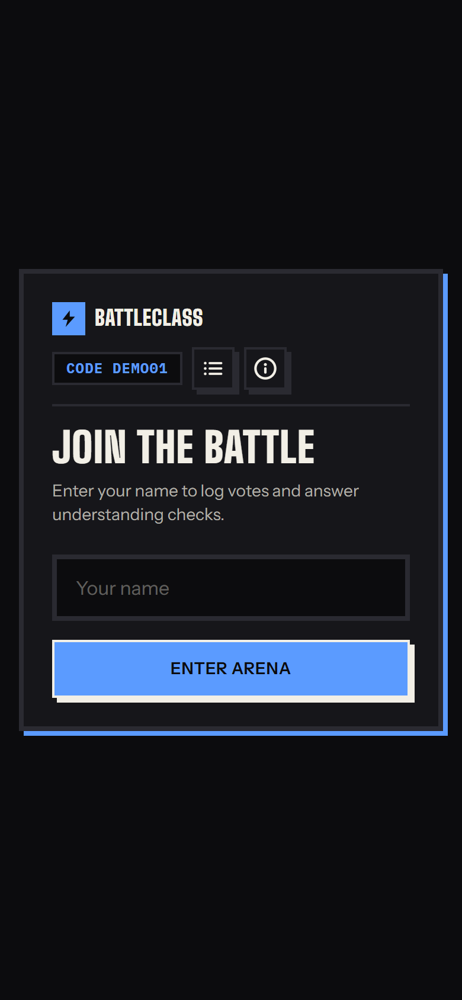 | 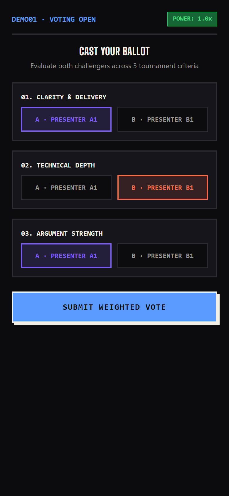 | 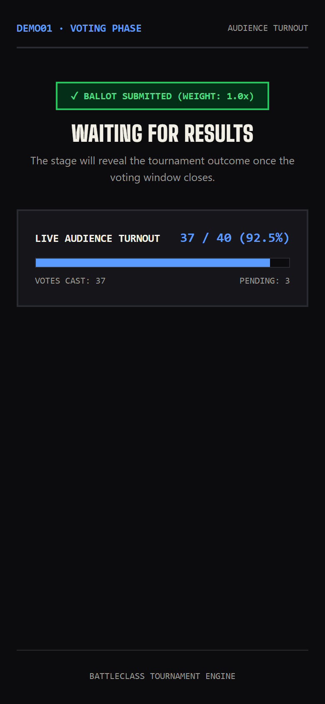 |
| *Live earned weight status.* | *Multi-criteria ballot submission.* | *Post-vote waiting screen.* |

---

### Organizer Command Console (1440 × 900)
| Tournament Battle List | Readiness Checklist | Order of Play Draw |
| :---: | :---: | :---: |
| 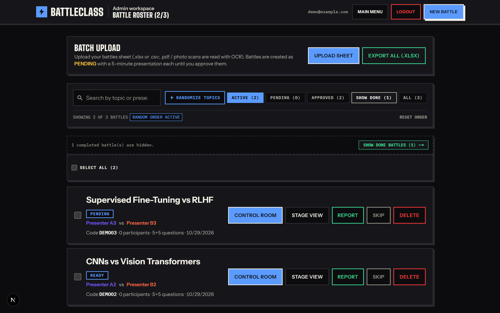 | 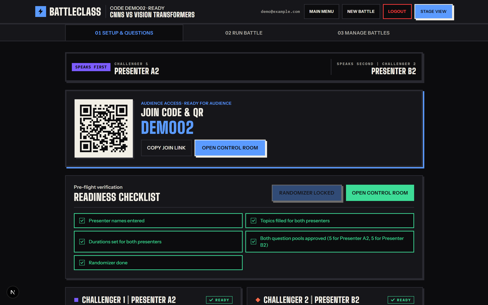 | 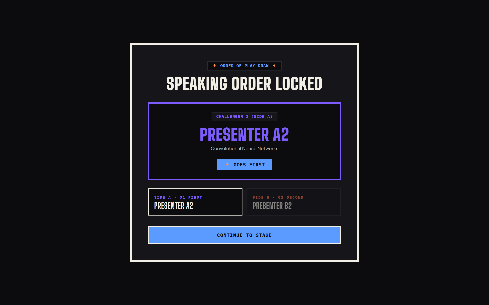 |
| *Roster overview across tournament.* | *Pre-flight configuration validation.* | *Speaking order draw animation.* |

---

### Analytics & Reports Previews
| Tournament Roster & Results Rollup | Detailed Attendee Response Log |
| :---: | :---: |
| 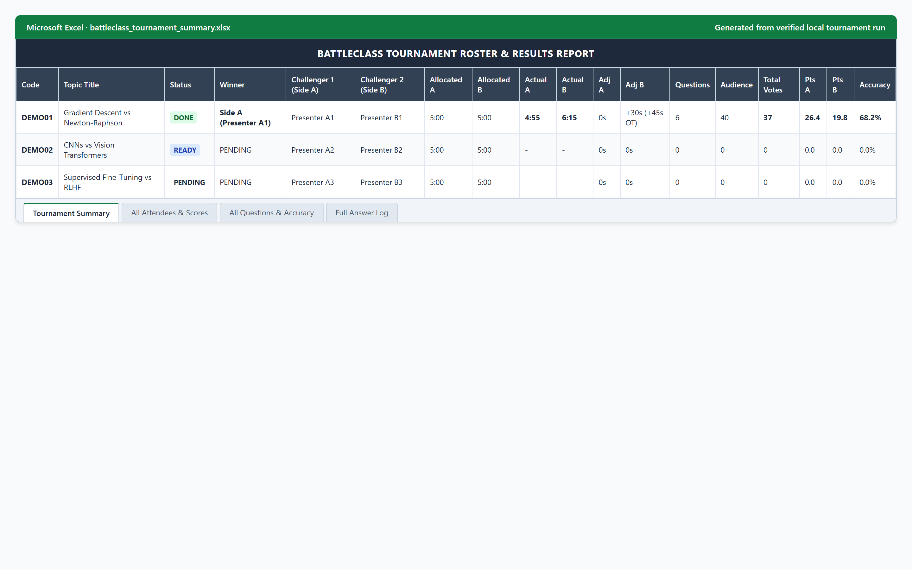 | 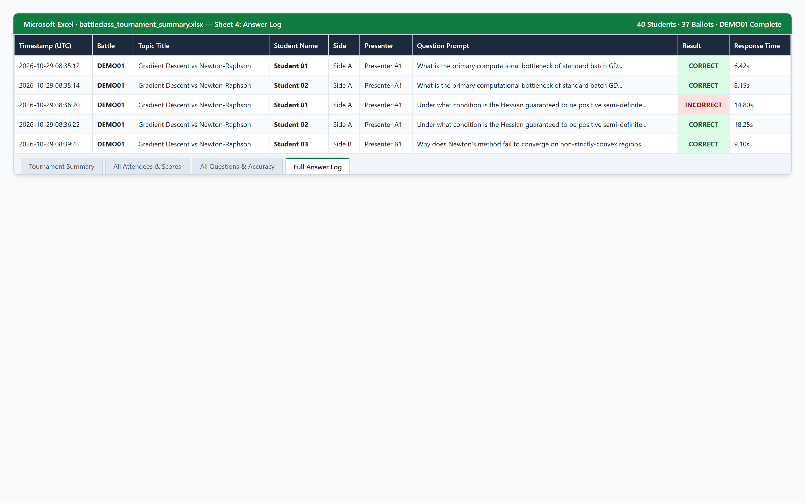 |
| *Multi-battle summary workbook with duration, turnout, and scores.* | *Item-by-item question submission latency and accuracy log.* |

---

## Analytics & Reporting

BattleClass includes an automated reporting engine generating multi-sheet Microsoft Excel workbooks (`.xlsx`) via OpenPyXL.

### Verified Computed Metrics
- **Audience Attendance & Turnout:** Records registered participant count and final ballot turnout rate (`ballots / participants`).
- **Speaking Time & Overtime:** Measures active presentation time elapsed in milliseconds. If a presenter exceeds their allotted duration, the report logs the exact `Overtime` duration (e.g., `+45s OT`) for instructor grading.
- **Comprehension Item Analysis:** Calculates per-question submission counts, response latency (seconds), option distribution percentages, and accuracy rates (`correct / total_answered * 100`).
- **Concept Struggle Identification:** The reporting workbook calculates per-question accuracy across all delivered checks. Rather than applying an automated heuristic flag, instructors sort the Question Performance sheet by accuracy to identify topics where audience comprehension was low.
- **Vote Weight Verification:** Audits each attendee's question answers by presenter side, calculated matched pairs, applied vote weight multiplier, and final criteria ballot choices.

*Sample reports generated from local test runs are available in [sample-reports/](sample-reports).*

---

## Architecture

BattleClass separates presentation state management from client interfaces, using Server-Sent Events (SSE) for low-latency broadcast distribution and a server-authoritative clock to eliminate client time drift.

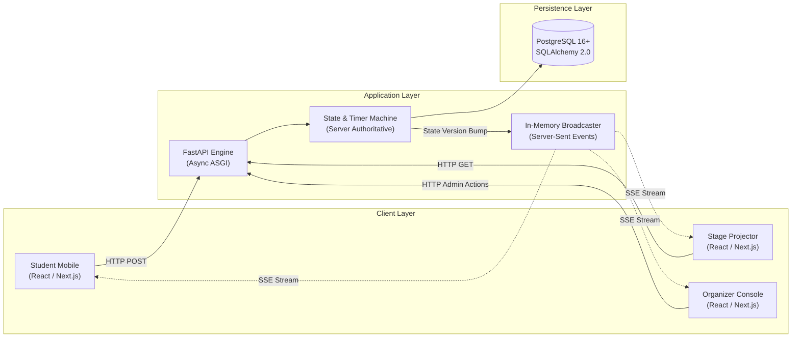

Detailed technical specifications:
- [System Architecture & Data Flow](docs/ARCHITECTURE.md)
- [Battle State Machine & Question Lifecycle](docs/STATE_MACHINE.md)
- [Relational Data Model (13 Tables & ER Diagram)](docs/DATA_MODEL.md)
- [Analytics & Export Specifications](docs/ANALYTICS.md)
- [Security Model & Known Limitations](docs/SECURITY.md)

---

## Tech Stack

| Layer | Technologies | Verified Manifest Versions |
| :--- | :--- | :--- |
| **Frontend Framework** | Next.js, React, TypeScript | Next.js `15.0.1`, React `19.0.0-rc`, TypeScript `5.6` |
| **Styling & Icons** | Tailwind CSS, Lucide | Tailwind CSS `3.4.14` |
| **Backend Framework** | FastAPI, Starlette, Pydantic | FastAPI `0.115.4`, Starlette `0.41.2`, Pydantic `2.9.2` |
| **ASGI Server** | Uvicorn | Uvicorn `0.32.0` |
| **Database & ORM** | PostgreSQL, SQLAlchemy, Alembic | SQLAlchemy `2.0.36`, Alembic `1.13.3`, psycopg `3.2.3` |
| **Authentication & Crypto** | Argon2id, Secrets | `argon2-cffi 23.1.0` |
| **Realtime Streaming** | Server-Sent Events (SSE) | Starlette `StreamingResponse` with in-memory Pub/Sub |
| **Reporting & Exports** | OpenPyXL | OpenPyXL `3.1.5` |
| **Testing Suite** | Pytest, Playwright / Puppeteer | Pytest `8.3.3`, pytest-asyncio `0.24.0` |

---

## By the Numbers

- **38 API Routes:** Covering authentication, tournament battles, live event feeds, checkpoints, and analytics.
- **13 Database Tables:** Complete relational schema with foreign key cascades and partial unique indexes.
- **245 Automated Tests:** Comprehensive unit and integration test suite covering backend routers, state machines, and report generation.
- **7 Core Web Views:** Specialized student, stage, and organizer layouts.


## Credits & Acknowledgements

[Your Acknowledgements Here]

---

## License

This project is licensed under the MIT License — see the [LICENSE](LICENSE) file for details.
