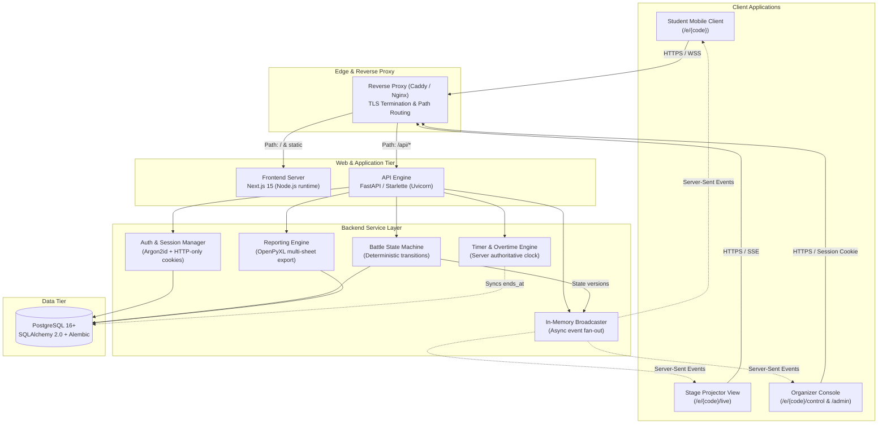
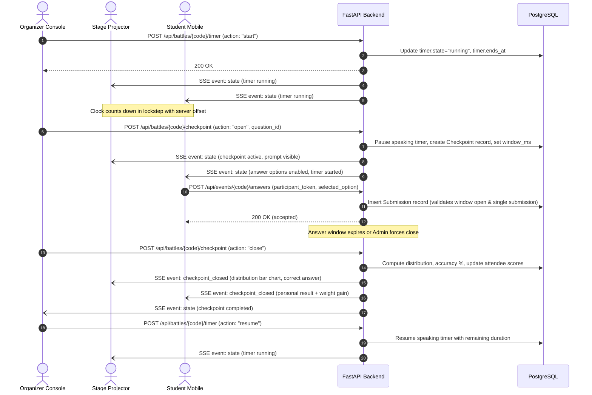
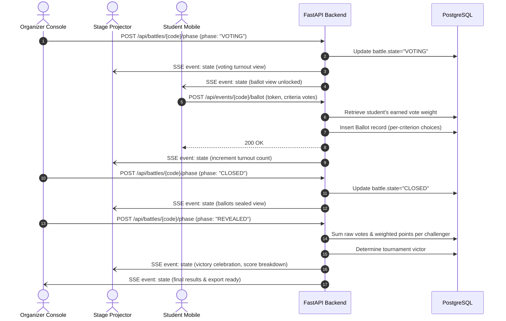

# System Architecture

This document describes the architectural design, component structure, data flow, and technology stack of BattleClass.

---

## 1. High-Level Architecture

BattleClass is organized as a decoupled web application comprising a Next.js client, a FastAPI asynchronous backend, and a PostgreSQL relational database. Live state synchronization between the organizer console, stage display, and audience smartphones is handled via Server-Sent Events (SSE).

---

## 2. Core Components

### 2.1 Frontend (Next.js 15)
- **Framework:** Next.js 15 using App Router and React 19.
- **Styling:** Tailwind CSS with high-contrast stage layouts and mobile-first student views.
- **Client Synchronization:** The `useBattleState` hook establishes an `EventSource` connection to the SSE feed, manages clock drift calibration against `server_time`, and triggers reactive view re-renders on version bumps.
- **View Modes:**
  - **Student View (`/e/[code]`):** Mobile-optimized responsive interface for entering join PINs, answering real-time understanding checks, monitoring earned vote power, and submitting weighted ballots.
  - **Stage Projector View (`/e/[code]/live`):** Fullscreen 1080p display for classroom projectors showing join QR codes, dual-challenger cards, circular countdown timer rings, live check accuracy distributions, and final winner celebration reveals.
  - **Organizer Console (`/e/[code]/control`):** Desktop command console for configuring battle parameters, importing and vetting question banks, controlling the speaking clock, dispatching questions, and opening/closing voting.
  - **Admin Dashboard (`/admin`):** Multi-battle management interface for creating tournaments, bulk approvals, status filtering, and downloading Excel reports.

### 2.2 Backend (FastAPI & Starlette)
- **Framework:** FastAPI with Python 3.12+, utilizing Starlette for ASGI routing and Pydantic v2 for payload validation.
- **Concurrency Model:** Fully asynchronous request handling powered by `asyncio` and `uvicorn`.
- **Authentication:** Admin authentication uses Argon2id password hashing stored in the database. Successful logins issue cryptographically signed, HTTP-only session cookies with `SameSite=Lax`.
- **Public Allowlist Security:** All API endpoints are protected by default under a global dependency check (`get_current_admin`), with explicit allowlist routing for public student interactions (`/api/events/{code}/*`).
- **Rate Limiting:** IP-based tracking limits brute-force attempts on admin login endpoints.

### 2.3 Realtime Event Streaming
- **Protocol:** HTTP Server-Sent Events (`text/event-stream`).
- **Broadcasting Mechanism:** An in-memory `Broadcaster` registry maintains active subscriber queues per battle code. When a battle transition occurs, the updated canonical state object is serialized and dispatched concurrently to all connected stage, student, and admin clients.
- **Clock Drift Mitigation:** Broadcasted payloads carry `server_time` (ISO-8601 UTC) and `server_now` (millisecond timestamp). Clients compute the offset (`server_now - Date.now()`) to ensure countdown rings and answer windows expire in strict lockstep across all devices regardless of client clock skew.

### 2.4 Data Tier (PostgreSQL)
- **Database Engine:** PostgreSQL 16+.
- **Database Access:** SQLAlchemy 2.0 with asynchronous drivers (`psycopg`).
- **Migrations:** Alembic version-controlled migration scripts.
- **Integrity Constraints:** Foreign key relations with cascading deletes, uniqueness constraints on battle codes and student participation tokens, and transactional state version checks.

---

## 3. End-to-End Data Flow

### 3.1 Presentation & Understanding Check Cycle

### 3.2 Voting & Results Calculation

---

## 4. Key Architectural Decisions

1. **Server-Sent Events over WebSockets:** The application requires low-latency server-to-client broadcasts (timer ticks, checkpoint launches, phase shifts), while student interactions are standard discrete HTTP POST requests (submitting an answer, casting a ballot). SSE provides native HTTP/2 multiplexing, automatic reconnection handling, and firewall compatibility without the protocol overhead of full-duplex WebSockets.
2. **Server-Authoritative Clock:** Clocks on student phones and classroom laptops often drift by several seconds. Timers never rely on client-side intervals for remaining time; the server broadcasts authoritative timestamps (`ends_at`, `remaining_ms`, `server_now`), and clients calculate remaining duration relative to the server clock.
3. **Optimistic Locking via State Versions:** All mutations to battle state check an integer `state_version`. If a concurrent request attempts to modify the battle from an outdated state, the backend rejects the transaction, preventing race conditions during fast-paced classroom presentations.
4. **Deny-by-Default Security:** The API routing layer enforces administrative authentication across all routes by default. Only endpoints explicitly designated for student participation are attached to an open public router.
