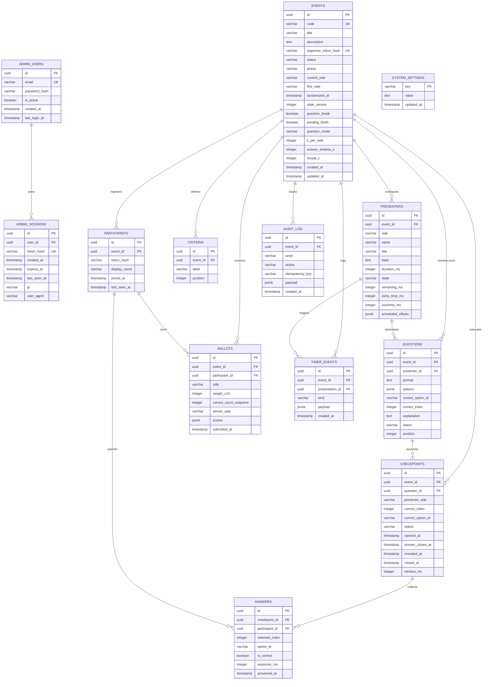

# Relational Data Model

This document details the complete relational database schema for BattleClass, including all 13 PostgreSQL tables, columns, constraints, indexes, and an entity-relationship diagram.

---

## 1. Entity-Relationship Diagram

---

## 2. Table Specifications

### 2.1 `admin_users`
Admin accounts authorized to create tournaments, modify configurations, and view exports.
- `id` (UUID, Primary Key)
- `email` (VARCHAR(255), Unique, Indexed)
- `password_hash` (VARCHAR(255)): Argon2id password hash.
- `is_active` (BOOLEAN, Default True): Access control flag.
- `created_at` (TIMESTAMPTZ, Server Default `NOW()`)
- `last_login_at` (TIMESTAMPTZ, Nullable)

### 2.2 `admin_sessions`
Active admin login sessions.
- `id` (UUID, Primary Key)
- `user_id` (UUID, Foreign Key `admin_users.id` ON DELETE CASCADE, Indexed)
- `token_hash` (VARCHAR(64), Unique, Indexed): SHA-256 hash of the 32-byte session token cookie.
- `created_at` (TIMESTAMPTZ, Server Default `NOW()`)
- `expires_at` (TIMESTAMPTZ, Indexed): Session expiration cutoff.
- `last_seen_at` (TIMESTAMPTZ, Server Default `NOW()`)
- `ip` (VARCHAR(64), Nullable): Client IP address for audit and revocation.
- `user_agent` (VARCHAR(500), Nullable): Client User-Agent string.

### 2.3 `events` (Battles)
Core tournament battle record representing a head-to-head presentation debate.
- `id` (UUID, Primary Key)
- `code` (VARCHAR(8), Unique, Indexed): Public alphanumeric battle PIN (e.g., `DEMO01`).
- `title` (VARCHAR(200)): Subject title of the debate.
- `description` (TEXT, Nullable)
- `organizer_token_hash` (VARCHAR(64), Unique, Indexed)
- `status` (VARCHAR(12), Default `'active'`): Operational status (`active`, `pending`, `done`).
- `phase` (VARCHAR(20), Default `'PENDING'`): Lifecycle state (`PENDING`, `READY`, `PRESENTING_1`, `WAITING_FOR_2`, `PRESENTING_2`, `ENDED`, `VOTING`, `CLOSED`, `REVEALED`).
- `current_side` (VARCHAR(1), Nullable): Active speaker side (`A` or `B`).
- `first_side` (VARCHAR(1), Nullable): Order of play draw winner (`A` or `B`).
- `randomized_at` (TIMESTAMPTZ, Nullable)
- `state_version` (INTEGER, Default 0): Optimistic locking revision counter.
- `question_break` (BOOLEAN, Default False)
- `pending_finish` (BOOLEAN, Default False)
- `question_mode` (VARCHAR(12), Default `'auto'`): Dispatch mode (`manual`, `auto`, `hybrid`).
- `k_per_side` (INTEGER, Default 3): Understanding checks per challenger side.
- `answer_window_s` (INTEGER, Default 5): Duration of question answering window in seconds.
- `reveal_s` (INTEGER, Default 3): Duration of answer reveal distribution screen in seconds.
- `created_at` (TIMESTAMPTZ, Server Default `NOW()`)
- `updated_at` (TIMESTAMPTZ, Server Default `NOW()`)
- *Constraints:* `CheckConstraint("k_per_side >= 1")`, `CheckConstraint("answer_window_s >= 1")`, `CheckConstraint("first_side IS NULL OR first_side IN ('A', 'B')")`.

### 2.4 `presenters`
Challengers representing Side A and Side B in a battle.
- `id` (UUID, Primary Key)
- `event_id` (UUID, Foreign Key `events.id` ON DELETE CASCADE, Indexed)
- `side` (VARCHAR(1)): Challenger marker (`'A'` or `'B'`).
- `name` (VARCHAR(200)): Display name of presenter.
- `title` (VARCHAR(300)): Topic sub-title or slide deck title.
- `topic` (TEXT, Nullable): Conceptual topic description.
- `duration_ms` (INTEGER, Default 0): Allocated speaking duration in milliseconds.
- `state` (VARCHAR(12), Default `'idle'`): Speaker clock status (`idle`, `running`, `paused`, `finished`).
- `remaining_ms` (INTEGER, Nullable): Authoritative remaining speaking milliseconds.
- `running_since` (TIMESTAMPTZ, Nullable): Time when clock last transitioned to `running`.
- `extra_time_ms` (INTEGER, Default 0): Administrative speaking time extensions.
- `overtime_ms` (INTEGER, Default 0): Time spoken beyond duration + extra time.
- `scheduled_offsets` (JSONB, Default `[]`): Timestamps within talk when checkpoints trigger.
- *Constraints:* `UniqueConstraint("event_id", "side")`.

### 2.5 `questions`
Question bank associated with a battle and presenter side.
- `id` (UUID, Primary Key)
- `event_id` (UUID, Foreign Key `events.id` ON DELETE CASCADE, Indexed)
- `presenter_id` (UUID, Foreign Key `presenters.id` ON DELETE CASCADE, Nullable, Indexed)
- `prompt` (TEXT): Question text.
- `options` (JSONB): Array of option objects `[{"id": "opt_0", "text": "..."}]`.
- `correct_option_id` (VARCHAR(40), Nullable)
- `correct_index` (INTEGER, Default 0): Zero-based option index of correct answer.
- `explanation` (TEXT, Nullable): Technical explanation shown upon reveal.
- `status` (VARCHAR(12), Default `'draft'`, Indexed): Preparation status (`draft`, `approved`, `discarded`).
- `position` (INTEGER, Default 0): Display ordering in question bank.
- *Constraints:* `CheckConstraint("jsonb_array_length(options) BETWEEN 2 AND 4")`.

### 2.6 `criteria`
Tournament judging criteria evaluated on student ballots.
- `id` (UUID, Primary Key)
- `event_id` (UUID, Foreign Key `events.id` ON DELETE CASCADE, Indexed)
- `label` (VARCHAR(100)): Criterion name (e.g., `Clarity`, `Technical Depth`, `Argument Strength`).
- `position` (INTEGER): Ballot display order.
- *Constraints:* `UniqueConstraint("event_id", "label")`.

### 2.7 `checkpoints`
Live execution runs of understanding check questions during presentations.
- `id` (UUID, Primary Key)
- `event_id` (UUID, Foreign Key `events.id` ON DELETE CASCADE, Indexed)
- `question_id` (UUID, Foreign Key `questions.id` ON DELETE SET NULL, Nullable)
- `presenter_side` (VARCHAR(1)): `'A'` or `'B'`.
- `correct_index` (INTEGER)
- `correct_option_id` (VARCHAR(40), Nullable)
- `status` (VARCHAR(12), Default `'active'`): Checkpoint status (`active`, `revealed`, `done`).
- `opened_at` (TIMESTAMPTZ, Server Default `NOW()`)
- `answer_closes_at` (TIMESTAMPTZ, Nullable)
- `revealed_at` (TIMESTAMPTZ, Nullable)
- `closed_at` (TIMESTAMPTZ, Nullable)
- `window_ms` (INTEGER): Answering duration window in milliseconds.
- *Constraints:* Partial unique index ensuring only one checkpoint can be `active` per battle at a time (`uq_checkpoint_one_active`), and a partial unique index ensuring a question is run at most once per battle (`uq_checkpoint_event_question`).

### 2.8 `participants`
Audience attendees connected to a battle session.
- `id` (UUID, Primary Key)
- `event_id` (UUID, Foreign Key `events.id` ON DELETE CASCADE, Indexed)
- `token_hash` (VARCHAR(64)): SHA-256 hash of the student participant token.
- `display_name` (VARCHAR(100), Nullable): Self-reported student identifier.
- `joined_at` (TIMESTAMPTZ, Server Default `NOW()`)
- `last_seen_at` (TIMESTAMPTZ, Server Default `NOW()`)
- *Constraints:* `UniqueConstraint("event_id", "token_hash")`.

### 2.9 `answers`
Student answer submissions to question checkpoints.
- `id` (UUID, Primary Key)
- `checkpoint_id` (UUID, Foreign Key `checkpoints.id` ON DELETE CASCADE, Indexed)
- `participant_id` (UUID, Foreign Key `participants.id` ON DELETE CASCADE, Indexed)
- `selected_index` (INTEGER): Option index chosen by the student.
- `option_id` (VARCHAR(40), Nullable)
- `is_correct` (BOOLEAN, Nullable): Scored correctness.
- `response_ms` (INTEGER, Nullable): Latency in milliseconds from question open to submission.
- `answered_at` (TIMESTAMPTZ, Server Default `NOW()`)
- *Constraints:* `UniqueConstraint("checkpoint_id", "participant_id")` enforcing one response per student per checkpoint.

### 2.10 `ballots`
Final tournament ballots cast by audience members during the voting phase.
- `id` (UUID, Primary Key)
- `event_id` (UUID, Foreign Key `events.id` ON DELETE CASCADE, Indexed)
- `participant_id` (UUID, Foreign Key `participants.id` ON DELETE CASCADE, Indexed)
- `side` (VARCHAR(1), Nullable): Overall winner selected (`'A'` or `'B'`).
- `weight_x10` (INTEGER, Nullable): Applied voter weight scaled by 10 (e.g., 10 = 1.0x, 13 = 1.3x).
- `correct_count_snapshot` (INTEGER, Nullable): Total comprehension checks scored correctly.
- `winner_side` (VARCHAR(1)): Chosen winner.
- `scores` (JSONB, Nullable): Per-criterion selections `{"Clarity": "A", "Technical Depth": "B", ...}`.
- `submitted_at` (TIMESTAMPTZ, Server Default `NOW()`)
- *Constraints:* `UniqueConstraint("event_id", "participant_id")` enforcing one ballot per participant.

### 2.11 `timer_events`
Append-only transactional log of all clock actions (start, pause, resume, extend, overtime).
- `id` (UUID, Primary Key)
- `event_id` (UUID, Foreign Key `events.id` ON DELETE CASCADE, Indexed)
- `presentation_id` (UUID, Foreign Key `presenters.id` ON DELETE CASCADE, Nullable, Indexed)
- `kind` (VARCHAR(24)): Action type (`start`, `pause`, `resume`, `extend`, `overtime_tick`).
- `payload` (JSONB, Default `{}`)
- `created_at` (TIMESTAMPTZ, Server Default `NOW()`)

### 2.12 `audit_log`
Administrative command audit log for idempotency and debugging.
- `id` (UUID, Primary Key)
- `event_id` (UUID, Foreign Key `events.id` ON DELETE CASCADE, Indexed)
- `actor` (VARCHAR(24), Default `'organizer'`)
- `action` (VARCHAR(40)): Command name.
- `idempotency_key` (VARCHAR(80), Nullable)
- `payload` (JSONB, Default `{}`)
- `created_at` (TIMESTAMPTZ, Server Default `NOW()`)
- *Constraints:* `UniqueConstraint("event_id", "idempotency_key")`.

### 2.13 `system_settings`
Global key-value configuration table (e.g., persistent tournament roster order).
- `key` (VARCHAR(64), Primary Key)
- `value` (TEXT)
- `updated_at` (TIMESTAMPTZ, Server Default `NOW()`)
