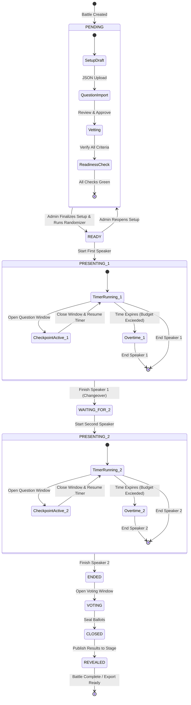
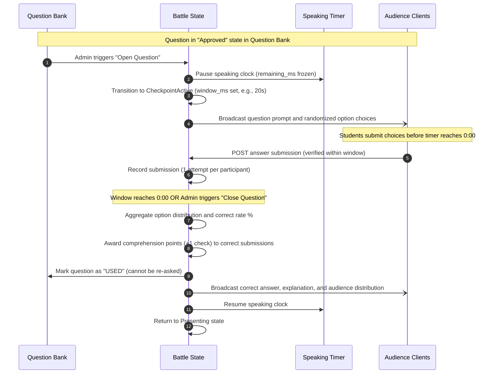

# Battle State Machine & Question Lifecycle

This document provides the formal state transition specifications for BattleClass battles, timers, and question checkpoints.

---

## 1. Battle State Machine

The battle lifecycle transitions through sequential states managed authoritatively by the organizer console. State transitions are verified transactionally and broadcast to all connected clients.

---

## 2. State Definitions & Permitted Triggers

| State | Role Responsible | Allowed Next States | Description & Behavior |
| :--- | :--- | :--- | :--- |
| **`PENDING`** | Admin / Organizer | `READY` | Battle draft. Admin configures presenter names, topics, speaking time, and imports the question bank. Questions are vetted and approved. |
| **`READY`** | Admin / Organizer | `PENDING`, `PRESENTING_1` | Setup locked. Order of play draw executed. Stage displays lobby with QR code and battle PIN. Audience joins and enters lobby. |
| **`PRESENTING_1`** | Admin / Organizer | `WAITING_FOR_2` | First speaker on stage. Speaking countdown active. Admin dispatches understanding checks (clock automatically pauses during questions). Overtime tracks if speech exceeds allocation. |
| **`WAITING_FOR_2`** | Admin / Organizer | `PRESENTING_2` | Changeover / intermission. Speaking clock reset for Challenger 2. Presenter transition on stage. |
| **`PRESENTING_2`** | Admin / Organizer | `ENDED` | Second speaker on stage. Speaking countdown active. Second set of understanding checks dispatched and answered. Overtime tracks if speech exceeds allocation. |
| **`ENDED`** | Admin / Organizer | `VOTING` | Presentations concluded. Both speakers have completed their talks and comprehension checks. |
| **`VOTING`** | Admin / Organizer | `CLOSED` | Final voting window open. Students submit ballots across criteria (Clarity, Technical Depth, Argument Strength). Stage shows live turnout percentage. |
| **`CLOSED`** | Admin / Organizer | `REVEALED` | Ballots sealed. System computes raw vote counts and weighted points based on earned student weights. |
| **`REVEALED`** | Admin / Organizer | *Terminal* | Victor announced on stage. Score breakdown, criteria comparisons, and participant results displayed. Battle is archived and available for Excel reporting. |

---

## 3. Question Checkpoint Lifecycle

During a presentation, the organizer triggers comprehension checks at strategic intervals. Each question follows a strict lifecycle to guarantee integrity:

### Key Checkpoint Rules:
1. **Clock Freezing:** The speaking timer automatically pauses while a question checkpoint is active, ensuring presentation time is not consumed by audience comprehension checks.
2. **Single-Attempt Enforcement:** A participant can submit only one answer per question checkpoint. Additional submissions from the same session token are rejected.
3. **One-Time Use:** Questions are consumed upon closing and cannot be relaunched within the same battle.
4. **Late Submissions:** Answers arriving after the window closes are rejected with an expired window error.
